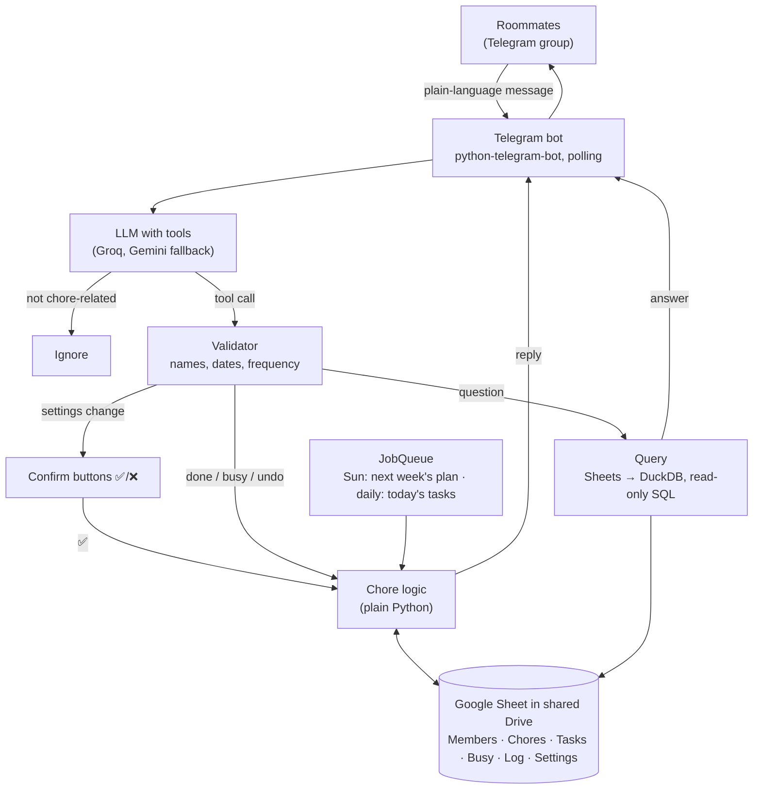

# Chore Bot

A Telegram group bot for three roommates. You set it up, log chores and ask questions in plain language.
All data lives in a Google Sheet in your shared Drive.

- **Scheduled chores** (dishwasher, mop, vacuum): each has a frequency. Every week one person rests and the other two
  split the tasks. If someone is busy, their tasks move to the other active person.
- **Turn-based chores** (trash): strict rotation. After someone does it, it's the next person's turn. If someone does it
  out of turn, the rotation continues from them.
- Any chore can include or exclude specific people.



## Code layout

| File | What it does |
|---|---|
| `chorebot/logic.py` | All chore rules: rest rotation, weekly plan, turns, busy, mark done, undo |
| `chorebot/llm.py` | Tool definitions, system prompt, providers (Groq/xAI via OpenAI-compatible API, Gemini) and fallback chain |
| `chorebot/assistant.py` | Message → LLM → validate → apply/confirm. No Telegram code, so it's testable |
| `chorebot/query.py` | Read-only DuckDB SQL over the sheet tabs |
| `chorebot/storage.py` | Google Sheets store (with a 60s cache) + in-memory store for tests |
| `chorebot/bot.py` | Telegram handlers, ✅/❌ buttons, reply-"undo", scheduled posts |
| `setup_sheet.py` | Creates the tabs and headers in your sheet |

## Setup (about 20 minutes)

**1. Telegram bot**
1. Message [@BotFather](https://t.me/BotFather) → `/newbot` → copy the token.
2. `/setprivacy` → pick your bot → **Disable**. This lets the bot read normal group messages.
3. Add the bot to your group. If it was already in the group, remove it and add it again so the privacy change applies.

**2. LLM key**: the default is [Groq](https://console.groq.com/keys) (free tier, `openai/gpt-oss-120b`) with Gemini
([Google AI Studio](https://aistudio.google.com/apikey)) as a backup. Choose with `LLM_PROVIDER` / `LLM_FALLBACK` in `.env`.

**3. Google Sheet + service account**
1. In [Google Cloud Console](https://console.cloud.google.com/), create a project and enable the **Google Sheets API**
   and **Google Drive API**.
2. Go to IAM & Admin → Service Accounts → create one → Keys → Add key → JSON. Save it as `service_account.json` in this
   folder.
3. Create a blank Google Sheet in your shared Drive folder. Share it with the service account's email
   (`...@...iam.gserviceaccount.com`) as **Editor**.
4. Copy the sheet ID from the URL: `docs.google.com/spreadsheets/d/<THIS_PART>/edit`.

**4. Run**
```bash
python -m venv .venv && source .venv/bin/activate
pip install -r requirements.txt
cp .env.example .env        # fill in the values
python setup_sheet.py       # creates the tabs
python -m pytest -q         # optional: run the tests
python -m chorebot.bot
```

**5. In the group**
```
I'm Atharva                      (each person, once)
Add dishwasher every day, mop every Saturday, vacuum Wednesday and Sunday
Trash is turn-based, Yuvraj goes first
Exclude Yuvraj from mopping
Arihant rests this week
What's the plan this week?
```
Settings changes show ✅/❌ buttons. After that, just log work normally:
`Yuvraj did mopping and Arihant vacuumed` · `took out trash` · `I'm busy till Sunday` ·
`whose turn is trash?` · `who did the most chores this month?`.
To reverse a logged chore or busy entry, reply **undo** to the bot's message.

## Hosting

The bot uses long polling, so it only needs to run on a machine that stays on. No public URL is required.
Options include a small VM, Railway or Fly.io (copy `.env` and `service_account.json` as secrets), or a Raspberry Pi.
If it runs on your laptop, it stops whenever the laptop sleeps.

## Notes

- You can edit the sheet by hand. The bot picks up changes within about a minute.
- To switch LLMs (e.g. to a local model through Ollama), implement `parse()` and `summarize()` in a new `LLM` subclass.
- Undo works for logged chores and busy entries while the bot keeps running. For settings, just tell the bot the fix.
